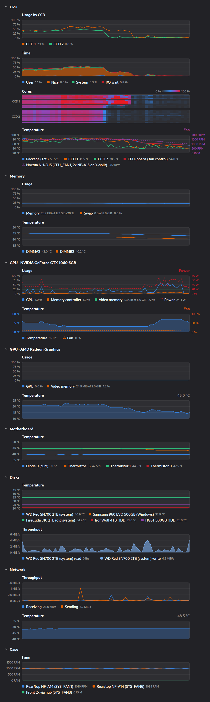

# System Status

A Linux system monitor in the style of GNOME System Monitor's Resources tab that also graphs what that one leaves out: CPU, DIMM, disk, GPU and motherboard temperatures, fan speeds, GPU utilization and power, per-CCD usage and clocks. The sections, the graphs, the series in each graph, the sensor labels and the legends all come from one TOML file. You change the layout by editing text, or by asking an agent to edit it, instead of clicking through a settings dialog.



## Features

- **Collapsible sections of graphs**: CPU, Memory, one section per GPU, Disks, Fans, Network and Motherboard by default, or any sections you define
- **Every hwmon sensor**: temperatures, fans, PWM duty and power, with IDs that stay the same across reboots, unlike `hwmon3`
- **CPU detail**: usage per CCD (L3 cache group), a heatmap of physical cores, clock per CCD, and where the CPU time goes (user, system, I/O wait)
- **GPUs**: NVIDIA through NVML, AMD through sysfs: utilization, video memory, temperature, fan and power
- **Disks and network**: read and write rates, receive and send rates, drive temperatures labelled with the drive model
- **Graph types**: lines, stacked areas, heatmaps, and a second y-axis on the right, such as a fan next to its temperatures
- **Live reload**: saving the settings file updates the window; a file with an error shows the error above the graphs and keeps the last good layout
- **Light and dark**: follows the desktop's color scheme, or set `theme`
- **X11 and Wayland**: Qt 6 with its own palette, so it looks the same on both

## Requirements

- Linux with sysfs. Developed on Ubuntu 24.04 with GNOME, under both X11 and Wayland.
- Python 3.12 or later, and [uv](https://docs.astral.sh/uv/) to install it.
- Optional: the NVIDIA proprietary driver, for NVIDIA GPUs. System Status loads its `libnvidia-ml.so`; without it there are no NVIDIA series, and nothing fails.
- Optional: the `drivetemp` kernel module, for the temperature of SATA drives. NVMe drives report theirs without it.

To load `drivetemp` now and at every boot:

```bash
sudo modprobe drivetemp
echo drivetemp | sudo tee /etc/modules-load.d/drivetemp.conf
```

System Status itself needs no root access: everything it reads is readable by any user.

## Installation

Install the `system-status` command with uv, straight from GitHub:

```bash
uv tool install git+https://github.com/fprochazka/system-status
```

Or from a clone, in editable mode, so a `git pull` updates it:

```bash
git clone https://github.com/fprochazka/system-status.git
cd system-status
uv tool install -e .
```

To upgrade an install from GitHub, run `uv tool upgrade system-status`, or `uv tool install --reinstall git+https://github.com/fprochazka/system-status`.

### Application launcher

To start System Status from the desktop's application list, like any other app, run:

```bash
system-status --install-desktop-entry
```

This writes the launcher `~/.local/share/applications/system-status.desktop` and the icon `~/.local/share/icons/hicolor/scalable/apps/system-status.svg`, or the same files under `$XDG_DATA_HOME` when it is set. The launcher runs the absolute path of the `system-status` command you ran. Install System Status with `uv tool install` first: the launcher then points at the `~/.local/bin/system-status` link that uv creates, which keeps working when the tool is reinstalled.

A `--config` given with `--install-desktop-entry` goes into the launcher as an absolute path; without one, the launcher uses the default settings file. The command checks that the settings file loads before it writes anything, and prints the paths it wrote. Run it again after you move System Status or the settings file. When `update-desktop-database` is installed, the command runs it on the applications directory. When the icon directory already has an icon cache, it also updates the cache with `gtk-update-icon-cache`. A failure of either is ignored.

The window's Wayland app id and X11 window class are `system-status`, the launcher's name, so GNOME's dock groups the window under the launcher and shows its icon.

### Uninstall

Remove the launcher and the icon first, while the command still exists, then the tool:

```bash
system-status --remove-desktop-entry
uv tool uninstall system-status
```

The settings file in `~/.config/system-status` stays; delete it by hand if you want.

## Usage

`system-status` without a command opens the window, the same as `system-status gui`.

```bash
# Open the window
system-status
system-status --config ./my-settings.toml --theme dark

# List every series of this machine: ID, label, current value, and why it is hidden
system-status sensors
system-status sensors --json

# Print the generated default layout of this machine as a settings file
system-status dump-config
# Write it to the settings file; --force overwrites an existing one
system-status dump-config --write

# Sample for 10 seconds, then save the whole window, unscrolled, as a PNG; no window appears
system-status screenshot /tmp/system-status.png --seconds 10 --theme dark --width 760

# Add or remove the application launcher and icon
system-status --install-desktop-entry
system-status --remove-desktop-entry

system-status version
```

Options:

| Option | Commands | Meaning |
|---|---|---|
| `--config`, `-c` | window, `gui`, `sensors`, `dump-config`, `screenshot` | The settings file. Default: `$XDG_CONFIG_HOME/system-status/settings.toml` |
| `--theme` | window, `gui`, `screenshot` | `auto`, `light` or `dark`; overrides `theme` from the settings file |
| `--install-desktop-entry` | window, `gui` | Install the launcher and the icon, then exit. See [Application launcher](#application-launcher) |
| `--remove-desktop-entry` | window, `gui` | Remove the launcher and the icon, then exit |
| `--json` | `sensors` | Print `{"series": [...], "unmatched_patterns": [...]}` instead of a table |
| `--write`, `--force` | `dump-config` | Write to the settings file instead of printing; `--force` overwrites an existing file |
| `--seconds`, `--width` | `screenshot` | How long to sample before the picture (default 5), and the window width in pixels (default 760) |

`--theme`, `--install-desktop-entry` and `--remove-desktop-entry` exclude each other. "window" means `system-status` without a command. Options before a command name apply only to the window: `system-status --config x.toml sensors` ignores `--config`, so write `system-status sensors --config x.toml`.

`sensors` samples twice, one second apart, because rates need two samples, then prints one line per series. Afterwards, it lists on stderr the `series` and `right` patterns of the settings file that match no series of this machine. It is the tool to find IDs for the settings file.

`dump-config` takes `history_seconds`, `interval_seconds`, `theme` and `[sensors]` from the current settings file and adds the generated default sections. Use it as a starting point for your own layout.

`screenshot` uses Qt's offscreen platform, so you can check a layout after editing the settings file without opening a window.

### In the window

Every graph shows the last `history_seconds`, newest on the right, with a vertical gridline every minute. All graphs share the same left and right margins, so one moment has the same horizontal position in every graph. Hover over a graph to see the time and the value of each series at that moment. Click a section header to collapse or expand it.

A graph with one series shows its current value at the right end of its title row, and no legend. A graph with more series shows a legend under the plot: a swatch, the label and the current value of each series, flowing left to right and wrapping when a line is full. Memory and video memory add the used and total bytes to the value, such as `25.2 GiB of 123 GiB · 20 %`.

## Configuration

The settings file is `~/.config/system-status/settings.toml`, or `$XDG_CONFIG_HOME/system-status/settings.toml` when that variable is set. Without the file, the window uses a [default layout](#default-layout) generated for this machine.

A minimal file that only relabels sensors in the default layout:

```toml
[sensors]
"hwmon:k10temp/Tctl" = { label = "CPU package" }
"hwmon:nct6687/fan1" = { label = "CPU cooler" }
```

A file with `[[section]]` tables replaces the default layout completely:

```toml
history_seconds = 300

[[section]]
title = "CPU"

  [[section.graph]]
  title = "Usage"
  series = ["cpu:total"]
  legend = false

  [[section.graph]]
  title = "Temperature"
  series = ["hwmon:k10temp/*"]
  right = ["hwmon:nct6687/fan1"]
```

### Validation and reloading

The file is checked strictly. An unknown key, a value of the wrong type or a value out of range is an error that names its place, such as `section[2].graph[0]: unknown key "lgend"; allowed: ...`. A typo in a key name never does nothing silently.

The window watches the file and reloads it about 0.2 seconds after it changes, also when an editor saves it by replacing the file:

- If the new file has an error, a red banner above the graphs shows it, and the previous layout stays.
- If it is valid, the window rebuilds its sections and graphs and keeps the sampled history.
- A change of `history_seconds` or `interval_seconds` restarts sampling with an empty history.
- A section that you collapsed or expanded by clicking keeps that state across reloads, matched by its title, until the window closes. Otherwise `collapsed` from the file applies.
- With `theme = "auto"`, the window also follows a change of the desktop's color scheme while it runs.

A problem found while matching series, such as a stacked graph whose patterns match several kinds, also shows in the banner.

### Top-level keys

| Key | Default | Meaning |
|---|---|---|
| `history_seconds` | `300` | How many seconds every graph shows, a whole number from 10 to 86400 |
| `interval_seconds` | `1.0` | How often everything is sampled, from 0.1 to 60 seconds. `history_seconds / interval_seconds` may be at most 100000 samples |
| `theme` | `"auto"` | `"auto"` follows the desktop, or `"light"`, `"dark"`. `--theme` overrides it |

### `[sensors]`

Overrides for single series, by exact ID, wherever the series is shown:

```toml
[sensors]
"hwmon:k10temp/Tctl" = { label = "CPU package", color = "#e01b24" }
"hwmon:nct6687/temp6" = { hidden = false }
"disk:Samsung_SSD_960_EVO_500GB/Sensor_1" = { hidden = true }
```

| Key | Type | Meaning |
|---|---|---|
| `label` | string | The name in legends, tooltips and heatmap rows |
| `color` | `"#rrggbb"` | The line, area and swatch color, instead of the [default color](#colors) |
| `hidden` | bool | `true` removes the series from every graph, even where a graph lists its exact ID. `false` lets globs match a series that is [hidden by default](#hidden-series) |

### `[[section]]`

Sections appear in file order, each with a clickable header.

| Key | Default | Meaning |
|---|---|---|
| `title` | required | The header text |
| `collapsed` | `false` | Start with the section collapsed |
| `graph` | none | The section's `[[section.graph]]` tables, in display order |

### `[[section.graph]]`

| Key | Default | Meaning |
|---|---|---|
| `title` | `""` | Shown above the plot, aligned with its left edge |
| `series` | required | Series IDs and globs (`*`, `?`, `[...]`) for the left axis, matched in order, each series once. A glob skips [hidden series](#hidden-series); an exact ID shows one |
| `type` | `"line"` | `"line"` draws a line per series. `"heatmap"` draws a row per series, see [Heatmaps](#heatmaps) |
| `kind` | kind of the first match | Keep only series of this [kind](#kinds) on the left axis. `hwmon:nct6687/*` with `kind = "fan"` keeps the fans of the chip and drops its temperatures |
| `legend` | `true` | Show the legend under a graph with more than one series. A graph with one series never has a legend |
| `hide_zero` | `false` | `true` leaves out each series that was 0 or missing for the whole visible history, such as unplugged fan headers. `"device"` leaves out a device's series only when all of them were 0, see [Hiding idle series](#hiding-idle-series) |
| `stacked` | `false` | Draw the left-axis series as filled areas on top of each other, see [Stacked graphs](#stacked-graphs) |
| `min`, `max` | 0 to 100 for percent, automatic otherwise | Fixed bounds of the left axis. `min` must be lower than `max` |
| `height` | `90` | Height of the plot in pixels, 30 to 1000. A heatmap ignores it |
| `row_height` | `7` | Height of one heatmap row in pixels, 2 to 40. Only with `type = "heatmap"` |
| `right` | `[]` | Series IDs and globs for a second y-axis on the right, see [Right axis](#right-axis) |
| `right_kind` | kind of the first right match | Keep only right series of this kind |
| `right_min`, `right_max` | 0 to 100 for percent, automatic otherwise | Fixed bounds of the right axis |
| `right_title` | derived | Shown above the right axis, see [Right axis](#right-axis) |

A graph never mixes kinds on one axis. On the left axis, series of another kind than the axis's are dropped. Two cases are errors in the banner instead, unless the graph sets the kind: a stacked graph whose `series` match several kinds (set `kind`), and `right` patterns that match several kinds (set `right_kind`).

#### Kinds

| Kind | Unit | Default axis |
|---|---|---|
| `percent` | % | 0 to 100 % |
| `temp` | °C | Fits the data, at least 10 °C tall |
| `fan` | RPM | From 0, at least 500 RPM tall |
| `power` | W | From 0, at least 5 W tall |
| `rate` | bytes per second, shown as B/s, KiB/s, MiB/s | From 0, at least 64 KiB/s tall |
| `voltage` | V | Fits the data, at least 0.5 V tall |
| `frequency` | MHz, shown as GHz | From 0, at least 1 GHz tall |

The minimum heights keep an idle disk or a steady temperature from filling the graph with noise.

#### Stacked graphs

With `stacked = true`, each left-axis series is an area on top of the previous one, and the top edge is their total. The axis scales to the total. The legend shows each series' own value, and the hover tooltip adds a `Total` row. A missing value counts as 0 while another series has a value at that moment.

Only kinds that add up can be stacked. `temp`, `voltage` and `frequency` can't, and neither can a heatmap. If a stacked graph's patterns match several kinds, the banner shows an error until you set `kind` or narrow `series`. Right-axis series are never stacked.

#### Right axis

`right` draws its series as dashed lines against a second y-axis on the right edge, with its own kind, unit and range. Use it for two related quantities in one graph, such as temperatures and a fan, or GPU usage and power.

- The right axis has no gridlines of its own: its ticks sit on the left axis's gridlines, with round values. A percent right axis keeps 0 to 100 % and may show thirds, such as 33 % and 67 %.
- In a graph with two axes, an axis with one series has its tick labels in that series' color.
- The legend swatch of a right-axis series is a dashed stroke with a small arrow pointing right.
- A series can't be on both axes. Listing the same ID in `series` and `right` is a config error; a glob that matches a series of `series` is an error in the banner.
- If the right patterns match several kinds, the banner shows an error until you set `right_kind`.
- A graph with a right axis doesn't show a current value in its title row. The right end of the title row shows `right_title` instead.
- Without `right_title`, the title is the label of the single right series when it has at most 20 characters, such as `Power` or `Fan`. Otherwise it is the kind's name: `Percent`, `Temperature`, `Fan`, `Power`, `Throughput`, `Voltage` or `Clock`.

#### Heatmaps

`type = "heatmap"` draws one thin row per series, time on the x-axis and the value as a color. The color goes from the plot background at 0 % through blue and purple to red at 100 %, so an idle row disappears into the background in both themes. The title row shows the color scale.

Rows are grouped by cluster with a gap between groups, and the cluster's name on the left. Today only `cpu:pcore<N>` series have a cluster, their CCD. Percent series use 0 to 100 %; other kinds use `min` and `max`, or the visible range. Hovering shows the row, the time and the value. A heatmap has no legend and no right axis, can't be stacked, and sizes itself from `row_height` and its rows.

#### Hiding idle series

`hide_zero = true` checks every series on its own. `hide_zero = "device"` groups the series of the graph by device: the ID up to the last `/`, such as `disk:WD_Red_SN700_2000GB`. A device's series are left out together, only when every one of them was 0 for the whole visible history. If one of them had activity, all of them are shown. In a disk throughput graph, an active disk then shows both its read and its write, and an idle disk neither. An ID without `/`, such as `cpu:total`, is its own device.

Both modes look at the whole visible history, so a series comes back as soon as one sample in the window is not 0. A graph whose series are all left out says `Nothing above zero`.

### Colors

A series without `color` in `[sensors]` gets a color from GNOME's palette: blue, orange, green, red, purple, yellow, teal, brown, pink, slate.

- A disk keeps one color in every graph, from its position among the machine's disks, so its temperature and its throughput look alike.
- A CCD keeps one color in every graph too: CCD 1 is orange and CCD 2 green in its usage, `Tccd` temperature and clock lines. Blue stays free for the total or the package next to them.
- A device's further series in the same graph get lighter shades of its color: a disk's write after its read, an NVMe drive's `Sensor_1` after `Composite`.
- Every other series takes the next palette color that the graph's devices don't use, in the graph's order.

## Series IDs

Every value the app can graph is a series. Its ID has the form `<group>:<device>/<metric>`, or `<group>:<metric>` for machine-wide values. IDs come from what the hardware reports about itself, such as the disk model, never from kernel numbering like `hwmon3` or `nvme1`, which changes between boots. Run `system-status sensors` to see the IDs of your machine with their labels and current values.

### CPU and memory

| ID | Meaning | Kind |
|---|---|---|
| `cpu:total` | Usage of all logical CPUs | percent |
| `cpu:core<N>` | Usage of one logical CPU, from `cpu:core0` | percent |
| `cpu:pcore<N>` | Usage of one physical core, labelled `Core <N+1>`: the busier of its SMT threads. One saturated thread already occupies most of a core, so the busier thread says more than the average | percent |
| `cpu:ccd<N>/usage` | Usage of the logical CPUs that share an L3 cache, labelled `CCD <N+1>`. On AMD Ryzen that is a CCD | percent |
| `cpu:ccd<N>/clock` | The highest current clock among the L3 group's CPUs (`scaling_cur_freq`), so a boosting core shows even while its neighbors sleep. Only with cpufreq | frequency |
| `cpu:user`, `cpu:nice`, `cpu:system`, `cpu:iowait`, `cpu:steal` | Share of all CPU time. `system` includes interrupt time. Stacked, they add up to the usage plus I/O wait | percent |
| `mem:used`, `swap:used` | Memory and swap in use; the legend adds the bytes | percent |

L3 groups and physical cores come from the kernel's topology files (`cache/index3/shared_cpu_list` and `topology/thread_siblings_list`), numbered from 0 by their lowest logical CPU. On a Ryzen 9 9950X, `ccd0` is CPUs 0–7 and 16–23, and `pcore0` is CPUs 0 and 16. A CPU with one L3 group, like most Intel desktop CPUs, has one `cpu:ccd0/usage`, which equals `cpu:total` and is hidden.

### Sensors (hwmon)

Each hwmon chip gets an ID prefix by what it measures:

| Prefix | Chips | Example |
|---|---|---|
| `hwmon:<chip>` | CPU sensors (`k10temp`, `coretemp`, `zenpower`) and every other chip, such as a Super-IO (`nct6687`, `it8686`) | `hwmon:k10temp/Tctl`, `hwmon:nct6687/fan11` |
| `dimm:<i2c address>` | DDR5 and DDR4 module sensors (`spd5118`, `jc42`) | `dimm:0x51/temp` |
| `disk:<model>` | NVMe drives (`nvme`) and SATA drives (`drivetemp`) | `disk:WD_Red_SN700_2000GB/Composite`, `disk:ST4000VN008-2DR1/temp` |
| `gpu:amd<N>` | AMD GPUs (`amdgpu`) | `gpu:amd0/edge`, `gpu:amd0/PPT` |
| `net:<interface>` | Sensors on a network card, such as its PHY | `net:enp7s0/temp` |

Within a chip, a sensor is named by its label, or by its channel when it has none:

- A labelled sensor uses the label: `Tctl`, `Composite`, `AMD_TSI_Addr_98h`.
- An unlabelled sensor uses its channel: `temp3`, `fan11`, `pwm2`.
- A chip's only unlabelled sensor of a kind is named after the kind: a SATA drive's temperature is `disk:ST4000VN008-2DR1/temp`.
- When two sensors of a chip have the same label, the first keeps the label and the next one gets its channel name, such as `hwmon:nct6687/temp6`.

hwmon temperatures are `temp`, fans `fan`, power sensors `power`, PWM duty `percent` and voltages `voltage`. Batteries, such as a wireless mouse's, are skipped.

### GPUs

Every GPU gets the same metric names, so a glob like `gpu:*/util` works across vendors.

| ID | Meaning | Kind |
|---|---|---|
| `gpu:nvidia<N>/util`, `gpu:amd<N>/util` | How busy the GPU is | percent |
| `gpu:nvidia<N>/mem_util` | How busy the memory controller is | percent |
| `gpu:nvidia<N>/vram`, `gpu:amd<N>/vram` | Video memory in use; the legend adds the bytes | percent |
| `gpu:nvidia<N>/temp` | GPU temperature | temp |
| `gpu:nvidia<N>/fan` | Fan speed in percent of full speed, as NVML reports it | percent |
| `gpu:nvidia<N>/power` | Power draw | power |
| `gpu:amd<N>/<sensor>` | The `amdgpu` hwmon sensors: `edge`, `junction`, `mem`, `PPT`, `fan`, … | temp, power, fan |

NVIDIA GPUs are numbered in NVML's order, AMD GPUs in PCI address order. A metric that a card doesn't report has no series. The default layout titles each GPU's section with the GPU's name; an AMD GPU without a `product_name` in sysfs is called `AMD Radeon Graphics`.

### Disks and network

| ID | Meaning | Kind |
|---|---|---|
| `disk:<model>/read`, `disk:<model>/write` | Disk throughput of a whole physical disk | rate |
| `net:total/rx`, `net:total/tx` | Received and sent bytes of all physical network interfaces | rate |
| `net:<interface>/rx`, `net:<interface>/tx` | Received and sent bytes of one interface | rate |

`net:total` counts only physical interfaces, because traffic through a bridge, a container's veth or a VPN tunnel also crosses a physical interface and would be counted twice.

### Names in IDs

- Models and labels become ID parts by replacing each run of characters other than letters, digits, `.`, `_`, `+` and `-` with `_`. `WD Red SN700 2000GB` becomes `WD_Red_SN700_2000GB`, and `Diode 0 (curr)` becomes `Diode_0_curr`. Case is kept, and matching is case-sensitive.
- Two disks of the same model get the kernel name: `disk:ST4000VN008-2DR1@sda`. Kernel names can change between boots, so these IDs are less stable than the others.
- Two chips of the same name, such as the sensors of two CPU sockets, get their device: `hwmon:k10temp@0000_40_18.3`.

### Hidden series

Some series exist but are hidden: a glob doesn't match them, and their exact ID does. `system-status sensors` lists each with the reason.

- Duplicates: a sensor with the same label and the same value as an earlier one of its chip, such as a Super-IO thermistor reported twice.
- Raw voltages: the `in` channels of any chip. A Super-IO reports them before the board's voltage dividers, so the numbers mean little without the board's documentation.
- Virtual network interfaces: bridges, veth pairs, VPN tunnels.
- `cpu:ccd0/usage` on a CPU with one L3 group, because it equals `cpu:total`.

`hidden = false` in `[sensors]` lets globs match a hidden series.

## Recipes

Each snippet is a part of a settings file. Run `system-status sensors` for the IDs of your machine; the ones below are from an AMD Ryzen 9 9950X with an MSI board.

### Relabel sensors

The Super-IO's fan headers have no labels, so give them the names of what is plugged in:

```toml
[sensors]
"hwmon:nct6687/fan1" = { label = "CPU cooler" }
"hwmon:nct6687/fan11" = { label = "Rear exhaust" }
"dimm:0x51/temp" = { label = "DIMM A2" }
"disk:WD_Red_SN700_2000GB/Composite" = { label = "System SSD" }
```

### Hide a sensor

`hidden = true` removes a series from every graph, globs and exact IDs alike. Here, an NVMe sensor that reads the same as the drive's `Composite`, and a fan header with nothing plugged in:

```toml
[sensors]
"disk:Samsung_SSD_960_EVO_500GB/Sensor_1" = { hidden = true }
"hwmon:nct6687/fan2" = { hidden = true }
```

### CPU usage per CCD and per core

```toml
[[section]]
title = "CPU"

  [[section.graph]]
  title = "Usage"
  series = ["cpu:total", "cpu:ccd*/usage"]

  [[section.graph]]
  title = "Cores"
  series = ["cpu:pcore*"]
  type = "heatmap"

  [[section.graph]]
  title = "Clock"
  series = ["cpu:ccd*/clock"]
```

### Where the CPU time goes

Nice and steal time are usually 0, so `hide_zero` leaves them out until they appear:

```toml
  [[section.graph]]
  title = "Time"
  series = ["cpu:user", "cpu:nice", "cpu:system", "cpu:iowait", "cpu:steal"]
  stacked = true
  hide_zero = true
```

### Temperatures with the fan that cools them

```toml
  [[section.graph]]
  title = "Temperature"
  series = ["hwmon:k10temp/Tctl", "hwmon:k10temp/Tccd1", "hwmon:k10temp/Tccd2"]
  right = ["hwmon:nct6687/fan1"]
```

The fan's label is long, so the right title falls back to `Fan`. Set `right_title` to choose another.

### GPU usage with power, temperature with fan

```toml
[[section]]
title = "GPU"

  [[section.graph]]
  title = "Usage"
  series = ["gpu:nvidia0/util", "gpu:nvidia0/mem_util", "gpu:nvidia0/vram"]
  right = ["gpu:nvidia0/power"]

  [[section.graph]]
  title = "Temperature"
  series = ["gpu:nvidia0/temp"]
  right = ["gpu:nvidia0/fan"]
```

### Disk throughput

List each disk's read and write next to each other, so the pair shares a color, with the write in a lighter shade:

```toml
  [[section.graph]]
  title = "Throughput"
  series = [
    "disk:WD_Red_SN700_2000GB/read",
    "disk:WD_Red_SN700_2000GB/write",
    "disk:ST4000VN008-2DR1/read",
    "disk:ST4000VN008-2DR1/write",
  ]
  stacked = true
  hide_zero = "device"
```

### Fans that spin

```toml
  [[section.graph]]
  title = "Fans"
  series = ["hwmon:nct6687/*"]
  kind = "fan"
  hide_zero = true
```

### A complete settings file

A shorter version of the settings file of the screenshot above:

```toml
history_seconds = 300
interval_seconds = 1
theme = "auto"

[sensors]
"disk:WD_Red_SN700_2000GB/Composite" = { label = "WD Red SN700 2TB (system)" }
"disk:WD_Red_SN700_2000GB/read" = { label = "WD Red SN700 2TB (system) read" }
"disk:WD_Red_SN700_2000GB/write" = { label = "WD Red SN700 2TB (system) write" }
"disk:ST4000VN008-2DR1/temp" = { label = "IronWolf 4TB HDD" }
"disk:ST4000VN008-2DR1/read" = { label = "IronWolf 4TB HDD read" }
"disk:ST4000VN008-2DR1/write" = { label = "IronWolf 4TB HDD write" }
"dimm:0x51/temp" = { label = "DIMMA2" }
"dimm:0x53/temp" = { label = "DIMMB2" }
"hwmon:nct6687/AMD_TSI_Addr_98h" = { label = "CPU (board / fan control)" }
"hwmon:nct6687/fan1" = { label = "Noctua NH-D15 (CPU_FAN1, 2x NF-A15 on Y-split)" }
"hwmon:nct6687/fan11" = { label = "Rear/top NF-A14 (SYS_FAN1)" }
"hwmon:nct6687/fan16" = { label = "Rear/top NF-A14 (SYS_FAN6)" }
"hwmon:nct6687/fan13" = { label = "Front 2x via hub (SYS_FAN3)" }

[[section]]
title = "CPU"

  [[section.graph]]
  title = "Usage by CCD"
  series = ["cpu:ccd*/usage"]

  [[section.graph]]
  title = "Time"
  series = ["cpu:user", "cpu:nice", "cpu:system", "cpu:iowait", "cpu:steal"]
  stacked = true
  hide_zero = true

  [[section.graph]]
  title = "Cores"
  series = ["cpu:pcore*"]
  type = "heatmap"

  [[section.graph]]
  title = "Temperature"
  series = [
    "hwmon:k10temp/Tctl",
    "hwmon:k10temp/Tccd1",
    "hwmon:k10temp/Tccd2",
    "hwmon:nct6687/AMD_TSI_Addr_98h",
  ]
  right = ["hwmon:nct6687/fan1"]

[[section]]
title = "Memory"

  [[section.graph]]
  title = "Usage"
  series = ["mem:used", "swap:used"]

  [[section.graph]]
  title = "Temperature"
  series = ["dimm:*/temp"]

[[section]]
title = "GPU · NVIDIA GeForce GTX 1060 6GB"

  [[section.graph]]
  title = "Usage"
  series = ["gpu:nvidia0/util", "gpu:nvidia0/mem_util", "gpu:nvidia0/vram"]
  right = ["gpu:nvidia0/power"]

  [[section.graph]]
  title = "Temperature"
  series = ["gpu:nvidia0/temp"]
  right = ["gpu:nvidia0/fan"]

[[section]]
title = "Motherboard"

  [[section.graph]]
  title = "Temperature"
  series = [
    "hwmon:nct6687/Diode_0_curr",
    "hwmon:nct6687/Thermistor_15",
    "hwmon:nct6687/Thermistor_1",
    "hwmon:nct6687/Thermistor_0",
  ]

[[section]]
title = "Disks"

  [[section.graph]]
  title = "Temperature"
  series = ["disk:WD_Red_SN700_2000GB/Composite", "disk:ST4000VN008-2DR1/temp"]

  [[section.graph]]
  title = "Throughput"
  series = [
    "disk:WD_Red_SN700_2000GB/read",
    "disk:WD_Red_SN700_2000GB/write",
    "disk:ST4000VN008-2DR1/read",
    "disk:ST4000VN008-2DR1/write",
  ]
  stacked = true
  hide_zero = "device"

[[section]]
title = "Network"

  [[section.graph]]
  title = "Throughput"
  series = ["net:total/rx", "net:total/tx"]

[[section]]
title = "Case"

  [[section.graph]]
  title = "Fans"
  series = ["hwmon:nct6687/fan11", "hwmon:nct6687/fan16", "hwmon:nct6687/fan13"]
```

## Default layout

Without `[[section]]` tables, the window lays out every useful series of the machine. `system-status dump-config` prints exactly this layout.

- **CPU**: usage, total and one line per CCD; a heatmap of the physical cores grouped by CCD; the CPU temperatures; the clock per CCD.
- **Memory**: memory and swap usage; DIMM temperatures.
- **GPU · \<name\>**, one per GPU: utilization, memory controller and video memory with power on a right axis; temperature with the fan on a right axis. An AMD GPU without a fan is an APU's integrated one; its `PPT` power sensor reads a fraction of a watt, so the default layout leaves it out.
- **Disks**: drive temperatures; one stacked throughput graph with the read and write of every disk and `hide_zero = "device"`.
- **Fans**: every fan that spun during the visible history.
- **Network**: received and sent bytes of the physical interfaces.
- **Motherboard**: the remaining temperatures, such as the Super-IO's and the network card's, and other power sensors.

Per-logical-CPU usage, the CPU time breakdown, PWM duty and per-interface traffic are not in the default layout. Add them by ID or glob.

## How it works

- The `system_status/core` package has no Qt imports. Sources read sysfs, `/proc/stat`, psutil and NVML. Each source finds its series once at startup and reads them on every tick.
- A sampler thread reads all sources every `interval_seconds` and keeps a ring buffer of `history_seconds` per series. Counters, such as disk sectors and CPU time, become rates inside the sources.
- The GUI pulls an immutable snapshot from the sampler four times a second with a `QTimer`, and repaints only when a new sample arrived. Qt code never touches the sampler's state.
- The graphs are painted with `QPainter`, with Qt's Fusion style and an Adwaita-like palette, so they look the same on X11 and Wayland whatever Qt theme plugin the desktop provides. The font comes from GNOME's `font-name` setting when it can be read.

## Development

```bash
uv sync
uv run system-status
uv run ruff check --fix . && uv run ruff format .
uv run pytest
```

The tests build a fake `/sys` tree of real files in a temporary directory, so they don't depend on the hardware of the machine that runs them. The GUI tests run with `QT_QPA_PLATFORM=offscreen`.

## Known limits

- Devices that appear after the start, such as a USB disk or a VPN interface, show up only after a restart.
- Intel GPU utilization is not read.
- NVIDIA fan speed is in percent of full speed, not in RPM, because NVML reports it that way.
- The meaning of the AMD `PPT` power sensor varies by chip; on an APU's integrated GPU it reads a fraction of a watt.
- One window per run: starting `system-status` twice opens two windows that sample separately.

## License

MIT
